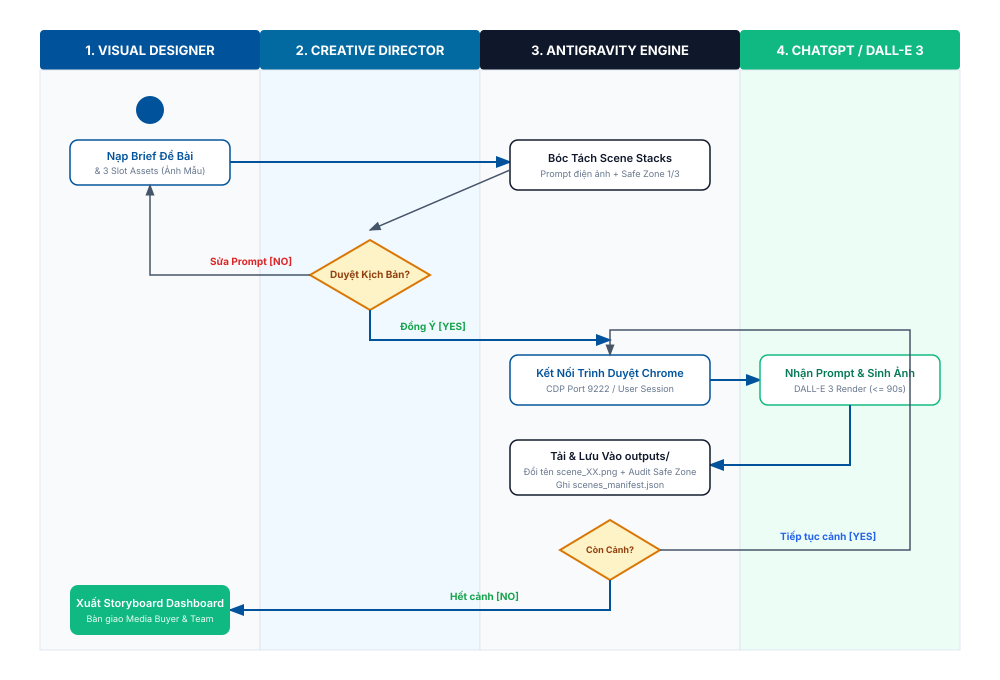
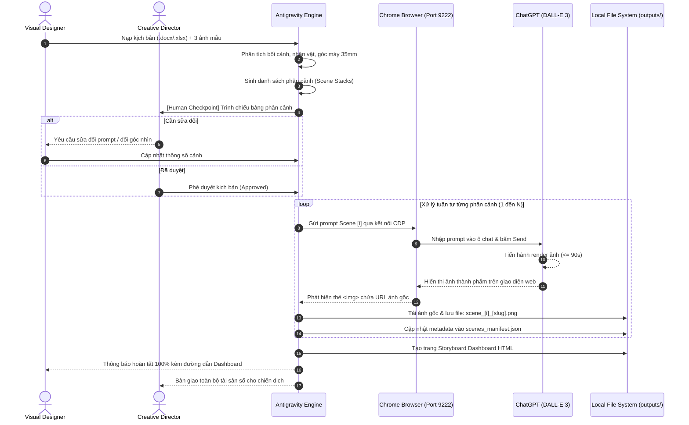
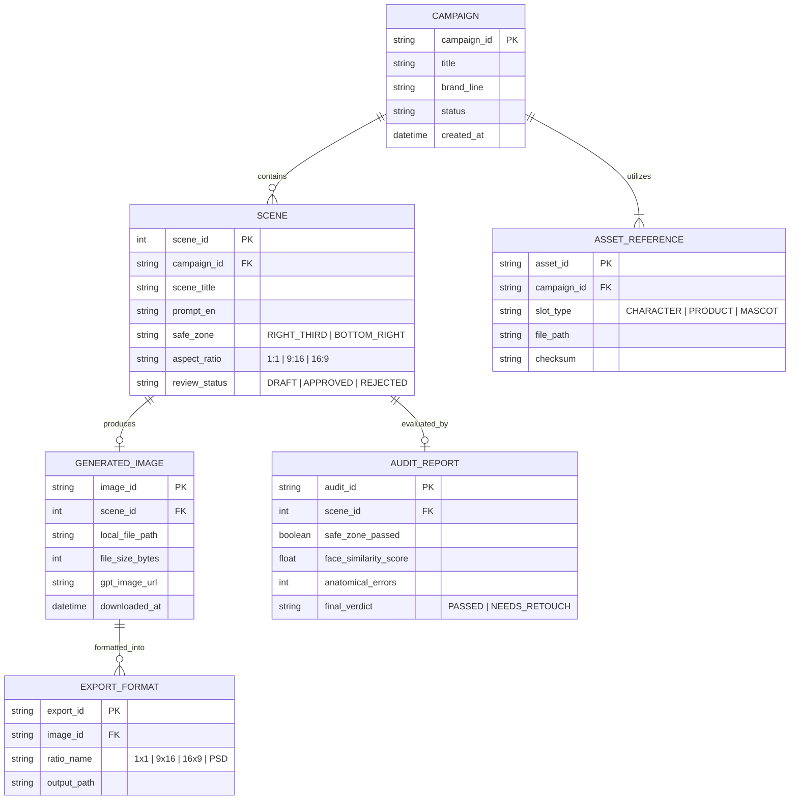
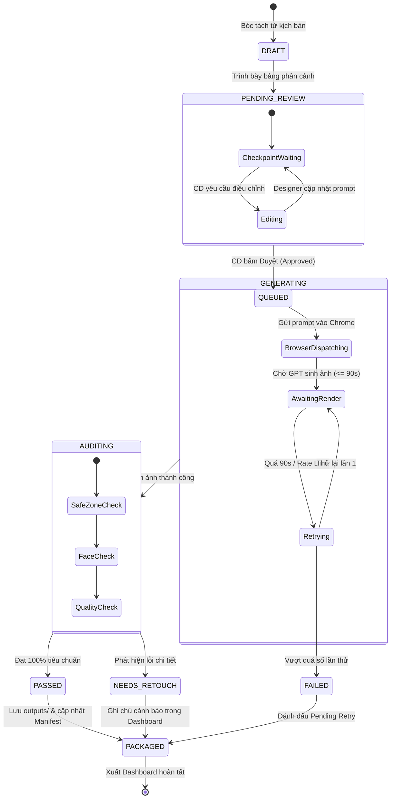

# PRD: Wintop AI Image Generator & Hybrid Design Autopilot Platform

> **Document Status**: Approved | Ready for Implementation  
> **Target Release**: Version 1.0 (Production Blueprint)  
> **Author**: Senior Solution Architect & IT-BA Lead  
> **Last Updated**: 2026-09-19  
> **Feature Slug**: `wintop-ai-design-autopilot`

---

## 1. Executive Summary & Problem Statement

### 1.1. Bối cảnh & Vấn đề (Context & Problem)
Thương hiệu Sữa dinh dưỡng **Wintop** (dòng sản phẩm chiến lược *Wintop Colostrum Gain* và *Wintop Baby*) liên tục triển khai các chiến dịch truyền thông quảng bá đa kênh (Trung Thu, Tết, Tăng cân chuẩn khoa học). Hiện nay, quy trình sản xuất bộ hình ảnh Key Visual (KV) và chuỗi phân cảnh kịch bản quảng cáo đang gặp 3 điểm nghẽn nghiêm trọng:
1. **Năng suất thủ công chậm chạp**: Mỗi hình ảnh thành phẩm đòi hỏi Designer và Retoucher mất từ **2 đến 4 tiếng** để tìm kiếm bối cảnh, dựng phối cảnh, ghép nhãn lon sản phẩm và chỉnh ánh sáng.
2. **Sai lệch nhận diện thương hiệu & Vị trí Safe Zone**: Khi làm việc gấp gáp, designer thường xuyên quên quy tắc vùng an toàn 1/3 (Safe Zone), đặt lon sữa hoặc Mascot che lấp khuôn mặt nhân vật, hoặc lệch tone màu chuẩn của thương hiệu.
3. **Mất tính nhất quán nhân vật (Cross-Scene Face Inconsistency)**: Khi triển khai chuỗi 10 - 15 phân cảnh liên tục, khuôn mặt của nhân vật chính (người mẹ công nhân, bé gái) bị biến đổi qua từng cảnh, khiến kịch bản bị "giả tạo" và giảm sút độ tin cậy của thông điệp thương hiệu.

### 1.2. Tầm nhìn & Mục tiêu Hệ thống (Product Vision & Goals)
Xây dựng nền tảng **Wintop AI Image Generator & Hybrid Design Autopilot** kết hợp sức mạnh của Antigravity IDE và công cụ AI tạo ảnh trên ChatGPT (DALL-E 3 / GPT-4o), tạo nên một quy trình tự động hóa khép kín:
- **Mục tiêu Năng suất**: Rút ngắn 85% thời gian sản xuất (từ 4 tiếng/ảnh xuống **dưới 60 giây/ảnh**).
- **Mục tiêu Nhất quán**: 100% hình ảnh sinh ra khóa chặt nhận diện thương hiệu Wintop, tuân thủ vùng an toàn Safe Zone 1/3 và đạt độ tương đồng gương mặt (**Face Similarity >= 95%**).
- **Mục tiêu Quản lý**: Tự động tải, đổi tên và lưu trữ ảnh tập trung vào thư mục dự án cục bộ (`outputs/anh_da_tao/`), xuất bản tức thì trang HTML Storyboard Dashboard cho Ban Giám đốc và Media Buyer nghiệm thu.

---

## 2. Target Personas & Permission Matrix

### 2.1. Chân dung Người dùng Mục tiêu (User Personas)

| Persona | Vai trò & Nhiệm vụ | Nhu cầu Cốt lõi | Thách thức / Rào cản |
|---|---|---|---|
| **Creative Director / Art Director** | Chỉ đạo nghệ thuật, duyệt kịch bản phân cảnh, chốt xuất bản | Duyệt nhanh chuỗi cảnh, đảm bảo tính thẩm mỹ điện ảnh và chuẩn Safe Zone | Quá tải vì phải duyệt thủ công hàng chục slide kịch bản rời rạc |
| **Visual Designer / AI Operator** | Nạp đề bài, chuẩn bị 3 slot ảnh mẫu, chạy công cụ sinh ảnh, sửa lỗi | Tự động hóa việc gửi prompt và lưu file, tập trung vào sáng tạo | Mệt mỏi vì phải copy-paste prompt sang web và tải từng file ảnh về đổi tên |
| **Media Buyer / Marketing Lead** | Tiếp nhận ảnh thành phẩm để triển khai chiến dịch quảng cáo | Nhận ảnh đúng kích thước (`1:1`, `9:16`, `16:9`), đúng hạn chiến dịch | Nhận ảnh sai tỉ lệ, vi phạm khoảng thở của giao diện TikTok/Reels |

### 2.2. Ma trận Phân quyền Chức năng (RBAC Matrix)

| Phân hệ / Thao tác chức năng | Visual Designer | Creative Director | Media Buyer | Quản trị viên (Admin) |
|---|:---:|:---:|:---:|:---:|
| Nạp đề bài & 3 Slot Assets mẫu | ✅ | ✅ | ❌ | ✅ |
| Bóc tách & Tinh chỉnh Prompt phân cảnh | ✅ | ✅ | ❌ | ✅ |
| **Phê duyệt kịch bản (Human Checkpoint)** | ❌ | ✅ | ❌ | ✅ |
| Kích hoạt trình duyệt mở GPT sinh ảnh | ✅ | ✅ | ❌ | ✅ |
| Tải và đổi tên ảnh vào `outputs/anh_da_tao/` | ✅ (Tự động) | ✅ (Tự động) | ❌ | ✅ |
| Xem trang Storyboard Dashboard | ✅ | ✅ | ✅ | ✅ |
| Xuất tệp đóng gói ZIP / PSD / Multi-Ratio | ✅ | ✅ | ✅ | ✅ |
| Cập nhật quy tắc thương hiệu (`brand_rules.json`) | ❌ | ✅ | ❌ | ✅ |

---

## 3. Scope & Phasing (P0 / P1 / P2)

```
┌──────────────────────────┬──────────────────────────┬──────────────────────────┐
│       P0: MVP Core       │     P1: Fast Follow      │   P2: Future & Growth    │
│ (Bắt buộc phải có để vận │ (Tối ưu chuyên sâu & gia │ (Điện ảnh hóa & tự động  │
│    hành chiến dịch ngay) │      tăng tiện ích)      │    hóa truyền thông)     │
├──────────────────────────┼──────────────────────────┼──────────────────────────┤
│ • Ingestion 3 Slot Assets│ • AI Upscaler 4K / 8K    │ • Tự động sinh video AI  │
│ • Bóc tách Scene Stacks  │ • Tự động tách 4 lớp PSD │   (Google Veo 3 / Sora)  │
│ • Trạm dừng duyệt kịch bản│ • Outpainting mở rộng ảnh│ • Tự động đẩy chiến dịch │
│ • Điều khiển browser GPT │ • Feedback Loop tự nâng  │   lên Facebook Ads &     │
│ • Lưu ảnh & Manifest JSON│   cấp tri thức nghiệp vụ │   TikTok Ads Manager     │
│ • Storyboard Dashboard   │                          │                          │
└──────────────────────────┴──────────────────────────┴──────────────────────────┘
```

- **Out of Scope (Ngoài phạm vi Phase 1)**:
  - Chưa hỗ trợ render video hoạt hình 3D phức tạp.
  - Chưa tích hợp hệ thống thanh toán tự động qua cổng ngân hàng.

---

## 4. High-Level Architecture & Use Case Diagram

### 4.1. Sơ đồ Use Case Tổng quan
Mô hình ca sử dụng bao quát toàn bộ ranh giới hệ thống, các tác nhân (Actors) và mối quan hệ nghiệp vụ:


### 4.2. Ranh giới Hệ thống & Các Khối Chức Năng (System Boundaries)
Hệ thống vận hành theo kiến trúc 4 khối tuần tự có kiểm soát:
1. **Khối 1 (Ingestion & Asset Manager)**: Quản lý 3 Slot dữ liệu mẫu tham chiếu cố định:
   - `Slot Character`: Ảnh chân dung nhân vật (Mẹ công nhân, Bé gái, Bà).
   - `Slot Product`: File PNG trong suốt Lon sữa Wintop Colostrum Gain 400g/800g.
   - `Slot Mascot`: File PNG trong suốt Linh vật Hươu cao cổ siêu nhân.
2. **Khối 2 (Script & Scene Engine)**: Trích xuất kịch bản và sinh danh sách phân cảnh (Scene Stacks) chuẩn Prompt điện ảnh tiếng Anh.
3. **Khối 3 (Checkpoint & Browser Automation Bridge)**: Cổng kiểm duyệt của Art Director kết nối qua Chrome DevTools Protocol (CDP port 9222) sang tab ChatGPT đang mở.
4. **Khối 4 (Storage, Packaging & Dashboard)**: Tự động tải tệp ảnh, định danh `scene_{id:02d}_{slug}.png`, ghi `scenes_manifest.json` và xuất bản trang HTML Storyboard Dashboard.

---

## 5. Functional Specifications & User Flows

### 5.1. Sơ đồ Phân Làn Trách Nhiệm (Activity Swimlane Diagram)
Quy trình phối hợp giữa 4 làn thực thi (Visual Designer, Creative Director, Antigravity Engine và ChatGPT):



### 5.2. Sơ đồ Tuần Tự (Sequence Diagram: Tương Tác Giữa Các Hệ Thống)



### 5.3. Đặc tả Cấu trúc Prompt Chuẩn Điện Ảnh (Cinematographic Prompt Structure)
Mỗi phân cảnh sinh ra bắt buộc tuân thủ công thức 5 thành tố:
```
[Subject & Action] + [Environment & Mood] + [Brand Asset Integration] + [Camera Angle & Lighting] + [Style & Quality Modifiers]
```
- **Ví dụ phân cảnh chuẩn**:
  > *"Cinematic shot of a 30-year-old tired Vietnamese female factory worker in worn uniform, tenderly looking at her 5-year-old daughter in a modest rental room. On the small wooden table in the right-third safe zone, place a sharp, clearly visible can of Wintop Colostrum Gain. Soft warm tungsten light 2700K from a bedside lamp, subtle blue moonlight rim light through the window. 35mm lens, f/1.8 aperture, photorealistic, 8k resolution, cinematic atmosphere."*

---

## 6. Data Model & Entity Relationships

### 6.1. Sơ đồ Quan hệ Thực thể (Entity-Relationship Diagram - ERD)



---

## 7. System States & Lifecycle

### 7.1. Vòng đời Chuyển đổi Trạng thái Phân cảnh (State Machine Diagram)



---

## 8. Edge Cases, Transaction Integrity & Limits

### 8.1. Ma trận Giao Dịch Bị Gián Đoạn (Interrupted Transactions Matrix)

| Tình huống rủi ro | Dữ liệu còn lại trên máy | Cơ chế Khôi phục (Resume Strategy) | Cơ chế Dọn dẹp (Cleanup Action) |
|---|---|---|---|
| Đóng trình duyệt Chrome hoặc mất điện giữa chừng | $M/N$ file ảnh đã tải về trong `outputs/anh_da_tao/` | Đọc file `scenes_manifest.json`, bỏ qua $M$ cảnh đã có và chỉ kích hoạt tiếp từ cảnh $M+1$ | Tự động quét và xóa bỏ các tệp tải dở dang kích thước 0 bytes |
| ChatGPT báo chạm hạn mức tin nhắn (Rate Limit) | Toàn bộ các cảnh trước đó được lưu an toàn | Dừng hàng đợi tự động, ghi nhận thời gian hồi phục và tạo file lệnh tiếp tục riêng | Bảo toàn trạng thái hàng đợi, không ghi đè dữ liệu cũ |
| Mạng rớt gói tin khi đang tải file ảnh | File ảnh tải dở chưa trọn vẹn | Thử tải lại liên kết ảnh tối đa 3 lần với khoảng cách 5 giây | Hủy file tải hỏng trước khi ghi đè bản mới |

### 8.2. Định Mức Số Liệu Nghiệp Vụ (Limits & Quotas)
- **Thời gian chờ phản hồi (Timeout)**: Tối đa **90 giây / ảnh**.
- **Số lần thử lại tự động (Max Retries)**: Tối đa **1 lần duy nhất** trước khi chuyển cảnh tiếp theo.
- **Quy mô phân cảnh trong 1 đợt chạy**: Từ **1 đến 20 phân cảnh** (khuyến nghị tối ưu 10 - 14 cảnh).
- **Kích thước file ảnh thành phẩm**: Dao động từ **1.5 MB đến 8.0 MB** (chuẩn Ultra HD).
- **Quy tắc đặt tên file**: Bắt buộc tuân thủ format: `scene_{id:02d}_{slug}.png` (ví dụ `scene_01_tan_ca_muon.png`).

### 8.3. Mẫu Câu Chữ Thông Báo Nghiệp Vụ Chuẩn (Wording Samples)
- **Thông báo Bắt đầu**: *"🚀 Khởi động phiên thiết kế tự động cho chiến dịch: [Tên chiến dịch]. Đang kết nối trình duyệt tới ChatGPT..."*
- **Thông báo Tiến độ**: *"⏳ Đang gửi Phân cảnh [X]/[N] vào GPT... Đã tạo xong và lưu trữ thành công [Tên file] ([Dung lượng] MB)."*
- **Cảnh báo Quá thời gian**: *"⚠️ Phân cảnh [X]/[N] bị quá thời gian phản hồi (>90s). Đang tự động thử lại lần 1..."*
- **Thông báo Bỏ qua**: *"⚠️ Phân cảnh [X]/[N] không thể hoàn tất sau 2 lần thử. Đã đánh dấu tạm hoãn để tiếp tục Phân cảnh [X+1]!"*
- **Thông báo Thành công**: *"🎉 CHÚC MỪNG! Đã hoàn tất tạo và lưu trữ [N]/[N] phân cảnh thành công tại `outputs/anh_da_tao/`! Bảng Storyboard Dashboard đã sẵn sàng tại [Link Dashboard]."*

---

## 9. Security, Brand Safety & Quality Audit

### 9.1. Quy Chuẩn Vùng An Toàn Thương Hiệu (Safe Zone & Brand Palette)
- **Hệ màu nhận diện**:
  - Primary Blue: `#00529B` (Màu xanh nhận diện cốt lõi thương hiệu Wintop).
  - Accent Gold: `#F5A623` (Màu vàng kim sữa non Colostrum Gain).
  - Canvas Dark: `#121621` (Màu nền tương phản cao phục vụ hiển thị sản phẩm).
- **Quy tắc Bố cục Safe Zone 1/3**:
  - Sản phẩm Lon Wintop và Mascot bắt buộc đặt ở **1/3 góc phải** hoặc **1/3 góc dưới**.
  - Tuyệt đối không để sản phẩm che khuất mắt, mũi hoặc miệng của nhân vật chính.
  - Tỷ lệ kích thước lon sữa so với người mẫu phải tương thích với kích thước lon 400g / 800g thực tế.

### 9.2. Kiểm Định Chất Lượng AI (AI Quality Audit)
- **Khóa Face ID**: Sử dụng mô tả nhân trắc học cố định xuyên suốt kịch bản để tránh lỗi biến dạng gương mặt.
- **Giải phẫu bàn tay (Anatomy Audit)**: Kiểm soát cử động tay, loại bỏ hoàn toàn các lỗi AI kinh điển (thừa ngón, thiếu ngón, dính ngón).
- **Bảo toàn Nhãn lon (Packaging Integrity)**: Đảm bảo chữ "Wintop Colostrum Gain" sắc nét, không bị AI tự biến thành các ký tự vô nghĩa.

---

## 10. Success Metrics (KPIs) & Roadmap

### 10.1. Chỉ Số Đo Lường Thành Công (North Star & Primary Metrics)

| Chỉ số (Metric) | Giá trị Hiện tại (Thủ công) | Chỉ số Mục tiêu (Hệ thống Tự động) | Đơn vị Đo lường |
|---|:---:|:---:|:---:|
| **Thời gian sản xuất 1 Key Visual** | 240 phút (4 tiếng) | **< 1 phút (30s - 60s)** | Phút / ảnh |
| **Độ tuân thủ vùng an toàn Safe Zone** | ~ 75% (phụ thuộc designer) | **100%** | Tỷ lệ phần trăm |
| **Tính nhất quán khuôn mặt (Face ID)** | ~ 60% (dễ lệch khi vẽ lại) | **>= 95%** | Điểm Cosine Similarity |
| **Thời gian nghiệm thu Storyboard** | 120 phút (cắt dán slide) | **< 30 giây** (Dashboard tự động) | Phút / chiến dịch |
| **Chi phí sản xuất trên mỗi chiến dịch** | 100% ngân sách chụp mẫu | **Giảm 80%** chi phí | VND / chiến dịch |

### 10.2. Lộ Trình Phát Triển Kỹ Thuật (Roadmap)
- **Giai đoạn 1 (Hiện tại - V1.0)**: Hoàn thành bóc tách kịch bản, trạm dừng Human Checkpoint, điều khiển trình duyệt GPT, lưu ảnh tự động và xuất bản Storyboard Dashboard.
- **Giai đoạn 2 (Tháng 10/2026 - V1.5)**: Tích hợp AI Upscaler 4K/8K và tự động tách lớp PSD 4 layer (SAM - Segment Anything Model).
- **Giai đoạn 3 (Quý 1/2027 - V2.0)**: Tích hợp mô hình AI Video (Google Veo 3 / Sora) để chuyển đổi Key Visual thành video TVC 5 - 15 giây tự động.

---

## 11. Appendices & References
- **Bản đặc tả Brainstorm 12 phần**: [BRAINSTORM_SPEC_WINTOP_DESIGN_AUTOPILOT.md](file:///c:/Users/Admin/Desktop/T%E1%BA%A1o%20%E1%BA%A3nh%20t%E1%BB%B1%20%C4%91%E1%BB%99ng/BRAINSTORM_SPEC_WINTOP_DESIGN_AUTOPILOT.md)
- **Quy chuẩn nhận diện thương hiệu Wintop**: [brand_rules.json](file:///c:/Users/Admin/Desktop/T%E1%BA%A1o%20%E1%BA%A3nh%20t%E1%BB%B1%20%C4%91%E1%BB%99ng/.agents/skills/wintop-design-autopilot/references/brand_rules.json)
- **Kịch bản thực nghiệm mẫu**: [Kich ban Trung Thu Wintop V3 mien Bac.xlsx](file:///c:/Users/Admin/Desktop/T%E1%BA%A1o%20%E1%BA%A3nh%20t%E1%BB%B1%20%C4%91%E1%BB%99ng/Kich%20ban%20Trung%20Thu%20Wintop%20V3%20mien%20Bac.xlsx)
- **Userscript điều phối Google Flow**: [wintop_google_flow_autopilot.js](file:///c:/Users/Admin/Desktop/T%E1%BA%A1o%20%E1%BA%A3nh%20t%E1%BB%B1%20%C4%91%E1%BB%99ng/wintop_google_flow_autopilot.js)
